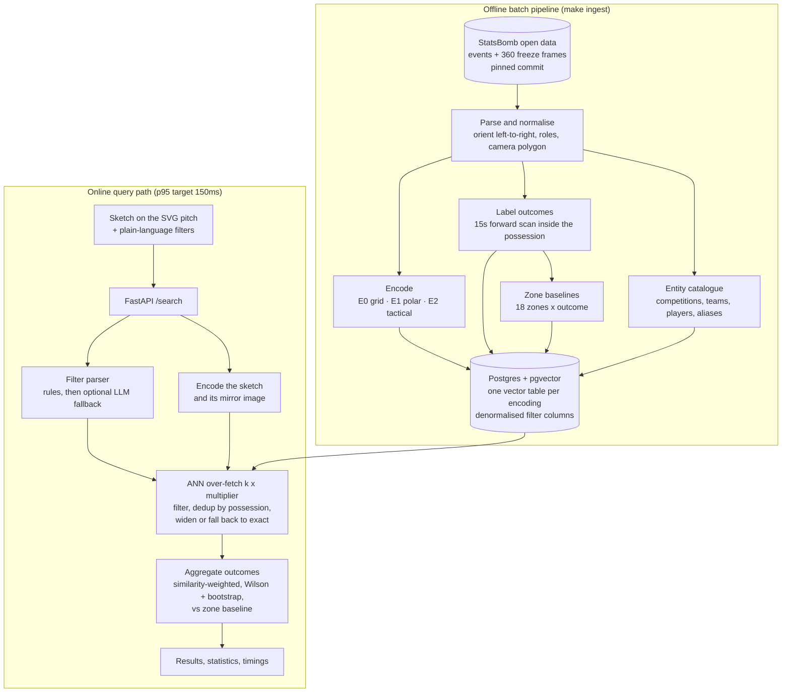

# Match Situation Search Engine


> _Placeholder: record `docs/media/demo.gif` from a local run — sketch a situation,
> watch the results and the outcome statistics update._

Sketch a soccer situation — where the ball is, where the attackers and defenders
stand — and get back the real moments from StatsBomb's open positional data that
look most like it, together with what actually happened next: how often those
situations produced a shot, how much xG they were worth, how often possession
was lost, how often the ball reached the box. Every number comes with a
confidence interval and a comparison against the baseline for that part of the
pitch, so "this shape is dangerous" is a claim you can check rather than a vibe.
Filters are written in plain language ("Bayern at home, last fifteen minutes,
trailing", where "at home" means the team in possession was the home side),
parsed by rules first and only then, optionally, by a model.

## Contents

- [How it works](#how-it-works)
- [Quick start](#quick-start)
- [The three encodings](#the-three-encodings)
- [Benchmarks](#benchmarks)
- [Observability](#observability)
- [Design notes](#design-notes)
- [Limitations](#limitations)
- [Development](#development)
- [Attribution](#attribution)

## How it works



The offline half is a batch job: it is allowed to be slow, and it is where all
the judgement lives (what counts as a turnover, how a frame is oriented, which
frames are usable at all). The online half only encodes, searches, dedups and
aggregates — that is what makes a 150ms budget realistic.

## Quick start

One command, with Docker:

```bash
make up      # builds the images, starts db + api + web, ingests the fixtures
             # app: http://localhost:8080   API docs: http://localhost:8000/docs
make down
```

No Docker, no Postgres — the in-memory store is exact by construction and the
fixture dataset is small enough to serve from it:

```bash
make install   # venv + backend (dev extras) + frontend deps
make ingest    # fixtures into an in-memory snapshot under .data/
make serve     # API on :8000
make web       # frontend on :5173
```

To run against the real dataset instead of the fixtures, point it at Postgres
and let it fetch StatsBomb open data at the pinned commit
(`4b73468fc5b0f1950f9f66fada70ad3a4f9327cb`, overridable with
`PITCHSCANNER_OPEN_DATA_COMMIT`):

```bash
docker compose up -d db
make migrate
make ingest-real
```

## Deploying to Vercel

`vercel.json`, `api/index.py` and the root `requirements.txt` deploy the app as
one Vercel project: the Vite build is served statically and the FastAPI app runs
as a single Python function behind rewrites for `/v1/*`, `/healthz`, `/readyz`,
`/metrics`, `/docs` and `/openapi.json`. The function serves an array store
from `api/_data/` (no database), which `scripts/vercel_build.sh` produces during
the build; see "Full dataset" below. To redeploy: `vercel deploy --prod` from the
repo root, linked to the project.

### Serving all of the real data without a database

The full 360 dataset (about 426 matches and 1.3M frames, StatsBomb open data at
`4b73468fc5b0f1950f9f66fada70ad3a4f9327cb`) does not fit in the in-memory store and
does not fit on any free Postgres. The **array store** serves it from files:

```bash
pitchscanner --store arrays ingest --out .data/arrays                 # all competitions
pitchscanner --store arrays ingest --out .data/arrays --competitions 55:282,9 --encodings E1
PITCHSCANNER_STORE=arrays PITCHSCANNER_ARRAYS_DIR=.data/arrays make serve
```

Ingest streams one match at a time into column buffers and writes the directory when
it finishes, so memory stays far below the size of the dataset. The directory holds
memory-mapped `.npy` files (a packed column per filter field, one vector file per
encoding, a sorted table of event ids, outcomes) plus `detail/<match_id>.json.gz` with
the players, camera polygon and events of each match. Search is exact: a boolean mask
from the filter columns, then distances over the surviving rows only, in chunks.
Vectors default to float32 for E1 and float16 for E0 and E2
(`PITCHSCANNER_ARRAYS_DTYPES=E1=float32,E2=float16`); an encoding that was not ingested
is simply absent and is not offered by the API. Detail files are read from
`<dir>/detail`, or from `PITCHSCANNER_DETAIL_BASE_URL` (a directory of
`<match_id>.json.gz` files) when set.

On Vercel, `api/index.py` serves the arrays when `PITCHSCANNER_ARRAYS_DIR` is set or a
store is bundled at `api/_data/`, and the fixtures otherwise.

### Full dataset on Vercel

The deployed site serves a data release, a pinned tarball of an array store, not
anything checked into git.

1. **Build it.** Run the `build-data` workflow (Actions, "Run workflow"; inputs
   `competitions`, empty for everything, and `encodings`, default `E1,E2`). It fetches
   StatsBomb at the pinned commit (blobless, only the matches that have 360 data),
   ingests into an array store, fails if the result looks wrong (under 1,000,000
   frames for a full build, no `meta.json`, more than 2 skipped matches), packs it as
   `pitchscanner-data-<statsbomb7>-<sha7>.tar.gz` (gzip level 1, cut into parts below
   GitHub's 2 GiB asset limit if needed), and publishes it with a `.sha256` and a
   `release.json` manifest under the release tag `data-<statsbomb7>-<sha7>`. The job
   summary has the ingest report and the sizes. About 513 MB is searchable and 417 MB
   is detail for the full set.
2. **Pin it.** Copy that release's `release.json` asset over `data/release.json` and
   commit it. While the file holds `null`, nothing is pinned.
3. **Deploy.** The Vercel `buildCommand` (`scripts/vercel_build.sh`) builds the frontend,
   then downloads the pinned release with `curl`, checks every part's sha256 and unpacks
   it as a stream into `api/_data/`, which `vercel.json` `includeFiles` ships inside the
   function. With nothing pinned it builds the small fixture array store there
   instead, so previews and forks run the same arrays code as production. The detail
   files are read from that bundled directory, so `PITCHSCANNER_DETAIL_BASE_URL` stays unset.
4. **Large functions.** The full set is far over the default function size limit (about
   225 MB here). The Vercel project needs the env var `VERCEL_SUPPORT_LARGE_FUNCTIONS=1`
   for production and preview, which raises it to 5 GiB.

To refresh after bumping `open_data_commit` (or changing the ingest code): merge the
change, run `build-data` again (the new tag carries the new StatsBomb and code
commits), replace `data/release.json` with the new manifest, commit and deploy. To roll
back, restore the previous `data/release.json`; old releases stay downloadable.

One of the 426 three-sixty files (Women's Euro 2022, match 3845506) has a run of NUL
bytes upstream. When the strict parse fails on a file with NULs, ingest recovers the
complete frames either side of the damage, records a reject (`salvaged three-sixty
file: recovered N frames, lost ~M`) and counts `matches_salvaged`. Any other unreadable
file still skips its match, and `--fail-on-bad-file` still aborts.

## The three encodings

A situation has no natural order — eleven players are a *set*, not a list — so
every encoding is built to be order-independent, and each one trades detail for
generality differently.

| id | what it is | dim | metric | good at | bad at |
| --- | --- | --- | --- | --- | --- |
| `E0` | 12x8 occupancy grid, 3 channels (attackers, defenders, unknown) + 4 ball features | 292 | cosine | literal shape matching; easy to explain and to debug visually | absolute positions, so a shape shifted 5m looks different; widest vectors, slowest search |
| `E1` | ball-relative polar bins, 4 rings x 8 sectors, per-ring smoothing | 72 | cosine | "who is near the ball, and where" — translation-invariant, the default | loses absolute pitch location unless the ball fixes it |
| `E2` | 18 named tactical features (compactness, defensive line height, numerical advantage near the ball, …) | 18 | L2 | cheap, interpretable, generalises across areas of the pitch | coarse: different shapes can share a feature vector, which the jitter check below shows |

`E1` is the default (`PITCHSCANNER_ENCODING=E1`). All three are built by the same
ingest run and stored side by side, so switching is a query parameter, not a
re-ingest.

Two details that matter more than the bin counts:

- **Unknown is not empty.** A 360 freeze frame only shows what the broadcast
  camera saw. Every encoding carries an explicit unknown mask derived from the
  camera polygon, so "no defender there" and "we cannot see there" are different
  inputs.
- **Mirroring happens at query time.** Situations are oriented left-to-right at
  ingest; the query is encoded twice, as drawn and mirrored across the halfway
  axis, so a sketch on the left touchline also finds its right-touchline twin
  without doubling the index.

## Benchmarks

Two committed reports, because they answer different questions:

- [`bench/reports/postgres/benchmark.md`](bench/reports/postgres/benchmark.md) —
  Postgres + pgvector with an HNSW index. **This is the one to read**: it is the
  production configuration, and the only place ANN recall means anything.
- [`bench/reports/benchmark.md`](bench/reports/benchmark.md) — the same harness
  against the in-memory store, which is the infrastructure-free path and the
  exact-search reference. Its recall column is 1.0 by definition and the report
  says so.

`make bench` regenerates whichever one the current `PITCHSCANNER_STORE` points at.
Nothing is quoted anywhere in this repo that is not in one of those files. Both
runs below are the **fixture** dataset (4 synthetic matches, 5,018 frames) on a
WSL2 laptop; repeat runs on the same machine vary by around 1.5x, which is why the
CI regression gate allows 2.5x.

Dataset:

| matches | events | frames | possessions | outcomes |
| --- | --- | --- | --- | --- |
| 4 | 8066 | 5018 | 1543 | 5018 |

Query latency on Postgres + pgvector/HNSW, 1000 queries per encoding,
milliseconds, stage columns are p95 for that stage:

| encoding | p50 | p95 | p99 | encode | search | dedup | aggregate | target |
| --- | --- | --- | --- | --- | --- | --- | --- | --- |
| E0 | 8.1 | 11.3 | 15.2 | 0.40 | 3.6 | 1.7 | 6.9 | PASS |
| E1 | 8.0 | 11.9 | 14.6 | 0.38 | 3.5 | 1.6 | 7.1 | PASS |
| E2 | 9.6 | 13.3 | 17.3 | 0.39 | 5.4 | 2.7 | 6.3 | PASS |

Targets: end-to-end p95 under 150ms, aggregation under 10ms, encoding under 1ms.
The aggregate column is the one worth watching — the first Postgres run had it at
30ms p95 because `_assemble` fetched the match and the frame inside its per-result
loop. See [`docs/design-notes.md`](docs/design-notes.md) §10.

**ANN recall against exact search**, 200 queries per configuration,
`ef_search=80`:

| encoding | k=10 | k=50 | k=10 filtered | target |
| --- | --- | --- | --- | --- |
| E0 | 1.000 | 1.000 | 1.000 | ≥ 0.95 |
| E1 | 1.000 | 1.000 | 1.000 | ≥ 0.95 |
| E2 | 1.000 | 1.000 | 1.000 | ≥ 0.95 |

Read that as "the index is losing nothing at this corpus size" rather than as a
claim about HNSW in general: 5,018 vectors is few enough that the graph walk is
close to exhaustive. The nightly job re-measures it and fails below 0.95.

Jitter sanity check — every player nudged 1–2m, the original frame should still
come back first:

| encoding | original ranked first | original in top 5 |
| --- | --- | --- |
| E0 | 1.000 | 1.000 |
| E1 | 1.000 | 1.000 |
| E2 | 0.505 | 0.785 |

That E2 row is the honest cost of an 18-dimensional summary, and it is the
reason E2 is offered as a lens rather than the default.

Index size (fixture dataset, 5018 vectors, HNSW):

| encoding | dim | metric | index bytes |
| --- | --- | --- | --- |
| E0 | 292 | cosine | 22.3 MB |
| E1 | 72 | cosine | 6.9 MB |
| E2 | 18 | L2 | 3.6 MB |

**FAISS, for comparison.** The spec's alternative to pgvector, benchmarked rather
than dismissed: same HNSW parameters, in process, over the same vectors.

| encoding | build | search p50 | search p95 | recall@10 |
| --- | --- | --- | --- | --- |
| E0 | 679ms | 0.10ms | 0.29ms | 1.000 |
| E1 | 588ms | 0.11ms | 0.22ms | 0.998 |
| E2 | 532ms | 0.09ms | 0.17ms | 1.000 |

FAISS searches the E1 index roughly sixteen times faster than pgvector does
(0.22ms vs 3.5ms p95), at recall 0.998 against exact search where pgvector
manages 1.000 — and the search stage is only 3.5ms of an 11.9ms end-to-end p95,
so adopting it would reclaim about 4ms inside a 150ms budget. The price is a second process owning an in-memory index that knows
nothing about the filter columns every query uses, plus the job of keeping it in
step with the database. pgvector stays. `pip install -e "backend[faiss]"` to reproduce the
table; without it the report says the comparison is missing rather than omitting
the section.

**Natural-language filters.** Two phrase sets, and they are not equally
trustworthy. [`data/eval/filter-phrases.jsonl`](data/eval/filter-phrases.jsonl)
has 145 phrases that I wrote alongside the parser, so its score says the parser
does what I had in mind, not that it generalises: **1.000 exact match** (145 of
145), per-field f1 of 1.000 across the ten filter fields. One label changed
along the way: "Germany against Spain" used to be labelled as both teams
defending, which cannot be true, and I relabelled it to Germany in possession,
which is how the parser reads it (it also warns that the opponent cannot be
filtered separately). The second set,
[`data/eval/filter-phrases-heldout.jsonl`](data/eval/filter-phrases-heldout.jsonl),
has 37 phrases (venue, "final third", "in the box", spelled-out and bounded minute
ranges, bare game states, "Bayern defending") taken from phrasings the first
version of the parser got wrong, and the test requires every one to parse
exactly: **37 of 37**. It is a regression set rather than an independent
estimate, because the parser was then fixed until it passed; a number from
phrases nobody had looked at would need someone else to write them. Zones are
approximations: the grid is 6 x 3, so "in the box" is the last column (x >= 100)
rather than the exact penalty area. `pytest tests/unit/test_filter_parsing.py -s`
prints both tables. The LLM fallback is off by default and is only consulted for
phrases the rules leave unresolved.

Selected dropdowns beat the text box. When they disagree the response says so
("Team from the text (Spain) is overridden by the selected filter") and drops the
text's chip instead of showing a filter that is not applied. Every chip records
the text it was read from, so removing it removes those words too.

**Retrieval quality.** `make eval-pool` builds a 200-query blind pool for hand
labelling. Until `bench/reports/eval-labels.jsonl` exists there are no
precision@10 or nDCG@10 numbers here, and the report refuses to invent any. The
metrics themselves are unit-tested against hand-computed values, including that
nDCG's ideal ranking comes from the whole pool rather than from the run being
scored.

**Tests.** 135 fast tests (unit, property-based, golden snapshots) plus 16
integration tests against a real Postgres with pgvector, plus 24 Playwright tests
across desktop and mobile viewports; 98% statement coverage on the core packages
(encoders, labeller, stats, geometry, filters) against an 85% gate.

## Observability

```bash
make up          # the app
make monitoring  # Prometheus, Grafana, and a blackbox probe of /readyz
                 # grafana: http://localhost:3000 (anonymous, local only)
```


> _Placeholder: screenshot `docs/media/grafana.png` from a local
> `make monitoring` run after some traffic._

Every request logs one structured JSON line carrying a request id (propagated
through a contextvar, so the id appears on log lines written deep in the search
service), and every response carries a `server-timing` header with the per-stage
breakdown. `GET /metrics` exposes request and per-stage latency histograms, cache
hits and misses, handled errors, rate-limit rejections, exact-scan fallbacks and
the vector count per encoding.

The dashboard in [`ops/grafana/dashboards/pitchscanner.json`](ops/grafana/dashboards/pitchscanner.json)
is provisioned automatically and shows eight panels: request percentiles with the
150ms budget drawn as a threshold line, per-stage p95 (so "which stage moved?" is
one glance, not an investigation), throughput by status, cache hit rate, errors
and rejections, exact-scan fallback rate, indexed vectors per encoding, and 24h
`/readyz` availability. [`ops/alerts.yml`](ops/alerts.yml) has three alerts and
deliberately no more: the service is down, the p95 has been over budget for ten
minutes, or the error rate is elevated.

## Design notes

Longer write-ups live in [`docs/`](docs/):

- [`docs/design-notes.md`](docs/design-notes.md) — the decisions worth arguing
  about: encoder trade-offs, possession dedup, the exact-search fallback,
  query-time mirroring, unknown-vs-empty, and how the statistics are computed.
- [`docs/blog-outline.md`](docs/blog-outline.md) — an outline for the write-up,
  starting from "why does a naive similarity search return the same play eight
  times?"

## Limitations

Read these before quoting anything from the demo.

- **Camera bias.** StatsBomb 360 freeze frames only contain players the
  broadcast camera saw. Off-screen players are unknown, not absent, and the
  visible area shrinks exactly when play is stretched — so wide, transitional
  situations are systematically less complete than settled ones near the ball.
- **Coverage skew.** The 360 data covers a handful of competitions (heavily
  tournament football), not a balanced sample of matches. `GET /v1/filters`
  reports exactly which competitions and seasons have frames in the index. Any
  cross-competition comparison inherits that skew.
- **The demo runs on fixtures.** The checked-in dataset is 4 synthetic matches
  generated by `scripts/make_fixture.py` with a fixed seed — enough to exercise
  every code path deterministically, far too small for a football conclusion.
  Statistics computed over it are arithmetic, not insight. Run `make ingest-real`
  for the real corpus.
- **Grid resolution.** Everything is a 120x80 pitch with 12x8 or 4x8 bins. That
  is roughly 10m cells: it cannot distinguish a defender's near shoulder from the
  far one, and it will call two distinct pressing shapes identical if they agree
  at that scale.
- **A frame is not a phase.** Each indexed vector is one instant. "What happened
  next" is a 15-second forward scan within the same possession and period, which
  is a choice, not a law: a shot at second 16 is invisible, and a possession that
  ends at a half boundary is truncated rather than extrapolated.
- **Similarity weighting is a heuristic.** Neighbours are weighted `1/(1+d)`, and
  the effective sample size (Kish) is reported alongside the raw count precisely
  because that weighting can make 40 neighbours behave like 12. Small samples are
  flagged `low_confidence` rather than hidden.
- **Outcome labels are event-derived.** "Turnover", "box entry" and "shot" are
  defined in `labeller.py` from StatsBomb event types; a foul won is not treated
  as a turnover, for instance. Reasonable people would draw some of those lines
  elsewhere.
- **No learned encoder.** `E3` — a trained embedding — is deliberately out of
  scope. All three encodings are hand-designed, which makes them explainable and
  keeps the quality ceiling where it is.

## Development

```bash
make help              # every target, with one-line descriptions
make test              # unit, property, golden, API
make test-integration  # needs Postgres + pgvector
make test-slow         # the nightly tier: deep property-test budget
make test-e2e          # builds the frontend, runs Playwright
make lint typecheck    # ruff + eslint, mypy (strict on core) + tsc
make bench             # rewrite bench/reports/
make perf-gate         # fresh quick benchmark vs the committed one
make openapi           # regenerate openapi.json and the TS types
```

CI ([`.github/workflows/ci.yml`](.github/workflows/ci.yml)) runs the same things
in cheapest-first order: lint and type-check, then the fast test tiers with the
coverage gate, then integration against a Postgres + pgvector service container,
then Docker image builds with Playwright against them, then the p95 regression
gate, and on merge to `main` it publishes images and deploys.

The slow tier runs nightly ([`.github/workflows/nightly.yml`](.github/workflows/nightly.yml)):
the property tests at a much larger Hypothesis budget, the full 1000-query
benchmark against a real pgvector index with a recall gate at 0.95, and an ingest
of the actual StatsBomb data at the pinned commit — the only job that notices if
upstream changes shape. The deep budget earns its place: it falsified the
mirroring property twice in ways the pull-request budget never reached, both
times by finding situations whose asymmetry lay entirely outside what the encoder
can see — the camera polygon for E0, the outermost ring for E1.

The frontend's TypeScript types are generated from the API's own OpenAPI schema,
and `frontend/src/lib/contract.ts` asserts at compile time that the hand-written
types the app uses actually match them — renaming a response field the app never
reads still fails the build.

## Attribution

Positional and event data from [StatsBomb Open Data](https://github.com/statsbomb/open-data),
used under its terms; StatsBomb requires attribution and this project is not
affiliated with or endorsed by StatsBomb. The fixture dataset in `data/fixtures/`
is synthetic and generated locally — it contains no StatsBomb data.
