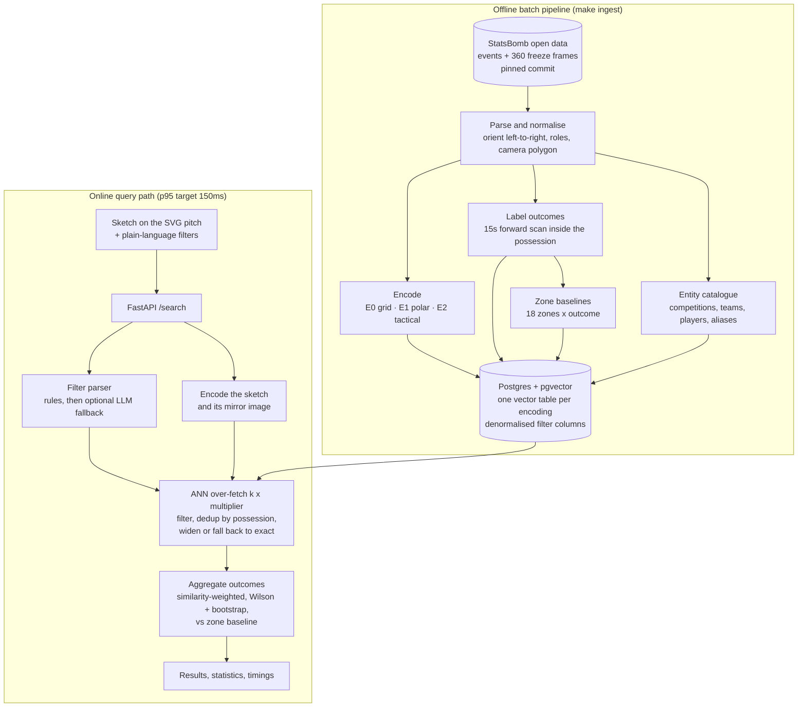

# Match Situation Search Engine


> _Placeholder: record `docs/media/demo.gif` from a local run — sketch a situation,
> watch the results and the outcome statistics update._

Sketch a soccer situation — where the ball is, where the attackers and defenders
stand — and get back the real moments from StatsBomb's open positional data that
look most like it, together with what actually happened next: how often those
situations produced a shot, how much xG they were worth, how often possession
was lost, how often the ball reached the box. Every number comes with a
confidence interval and a comparison against the baseline for that part of the
pitch, so "this shape is dangerous" is a claim you can check rather than a vibe.
Filters are written in plain language ("Bayern at home, last fifteen minutes,
trailing"), parsed by rules first and only then, optionally, by a model.

## Contents

- [How it works](#how-it-works)
- [Quick start](#quick-start)
- [The three encodings](#the-three-encodings)
- [Benchmarks](#benchmarks)
- [Design notes](#design-notes)
- [Limitations](#limitations)
- [Development](#development)
- [Attribution](#attribution)

## How it works



The offline half is a batch job: it is allowed to be slow, and it is where all
the judgement lives (what counts as a turnover, how a frame is oriented, which
frames are usable at all). The online half only encodes, searches, dedups and
aggregates — that is what makes a 150ms budget realistic.

## Quick start

One command, with Docker:

```bash
make up      # builds the images, starts db + api + web, ingests the fixtures
             # app: http://localhost:8080   API docs: http://localhost:8000/docs
make down
```

No Docker, no Postgres — the in-memory store is exact by construction and the
fixture dataset is small enough to serve from it:

```bash
make install   # venv + backend (dev extras) + frontend deps
make ingest    # fixtures into an in-memory snapshot under .data/
make serve     # API on :8000
make web       # frontend on :5173
```

To run against the real dataset instead of the fixtures, point it at Postgres
and let it fetch StatsBomb open data at the pinned commit:

```bash
docker compose up -d db
make migrate
make ingest-real
```

## The three encodings

A situation has no natural order — eleven players are a *set*, not a list — so
every encoding is built to be order-independent, and each one trades detail for
generality differently.

| id | what it is | dim | metric | good at | bad at |
| --- | --- | --- | --- | --- | --- |
| `E0` | 12x8 occupancy grid, 3 channels (attackers, defenders, unknown) + 4 ball features | 292 | cosine | literal shape matching; easy to explain and to debug visually | absolute positions, so a shape shifted 5m looks different; widest vectors, slowest search |
| `E1` | ball-relative polar bins, 4 rings x 8 sectors, per-ring smoothing | 72 | cosine | "who is near the ball, and where" — translation-invariant, the default | loses absolute pitch location unless the ball fixes it |
| `E2` | 18 named tactical features (compactness, defensive line height, numerical advantage near the ball, …) | 18 | L2 | cheap, interpretable, generalises across areas of the pitch | coarse: different shapes can share a feature vector, which the jitter check below shows |

`E1` is the default (`PITCHSCANNER_ENCODING=E1`). All three are built by the same
ingest run and stored side by side, so switching is a query parameter, not a
re-ingest.

Two details that matter more than the bin counts:

- **Unknown is not empty.** A 360 freeze frame only shows what the broadcast
  camera saw. Every encoding carries an explicit unknown mask derived from the
  camera polygon, so "no defender there" and "we cannot see there" are different
  inputs.
- **Mirroring happens at query time.** Situations are oriented left-to-right at
  ingest; the query is encoded twice, as drawn and mirrored across the halfway
  axis, so a sketch on the left touchline also finds its right-touchline twin
  without doubling the index.

## Benchmarks

Numbers below are copied from [`bench/reports/benchmark.md`](bench/reports/benchmark.md),
which `make bench` regenerates; the tables here are a snapshot of that file at
commit `a475a4e`, and nothing is quoted anywhere in this repo that is not in it.
This run is the **fixture** dataset on the in-memory store, on a WSL2 laptop, so
treat the absolute milliseconds as a shape rather than a spec — repeat runs on
the same machine vary by around 1.5x, which is why the CI regression gate allows
2.5x.

Dataset:

| matches | events | frames | possessions | outcomes |
| --- | --- | --- | --- | --- |
| 4 | 8066 | 5018 | 1543 | 5018 |

Query latency, 1000 queries per encoding, p95 in milliseconds, stage columns are
p95 for that stage:

| encoding | p50 | p95 | p99 | encode | search | dedup | aggregate | target |
| --- | --- | --- | --- | --- | --- | --- | --- | --- |
| E0 | 9.3 | 19.7 | 28.4 | 0.57 | 16.7 | 0.26 | 3.3 | PASS |
| E1 | 1.7 | 3.0 | 3.9 | 0.32 | 1.4 | 0.17 | 1.3 | PASS |
| E2 | 1.3 | 2.1 | 2.7 | 0.20 | 0.8 | 0.09 | 1.0 | PASS |

Targets: end-to-end p95 under 150ms, aggregation under 10ms, encoding under 1ms.

Jitter sanity check — every player nudged 1–2m, the original frame should still
come back first:

| encoding | original ranked first | original in top 5 |
| --- | --- | --- |
| E0 | 1.000 | 1.000 |
| E1 | 0.995 | 1.000 |
| E2 | 0.505 | 0.790 |

That E2 row is the honest cost of an 18-dimensional summary, and it is the
reason E2 is offered as a lens rather than the default.

Index size (fixture dataset, 5018 frames):

| encoding | dim | metric | bytes |
| --- | --- | --- | --- |
| E0 | 292 | cosine | 5.9 MB |
| E1 | 72 | cosine | 1.4 MB |
| E2 | 18 | L2 | 0.36 MB |

**ANN recall.** The committed report's recall table was produced against the
in-memory store, which is exact by construction — those 1.0s are definitional
and are marked as such in the report. Recall only means something against
pgvector with an HNSW index, which is why the CI `integration` job re-runs the
recall benchmark against a real Postgres service container and the report's own
caveat tells you not to quote a memory run.

**Natural-language filters.** 145 hand-labelled phrases in
[`data/eval/filter-phrases.jsonl`](data/eval/filter-phrases.jsonl); the rule
parser scores **1.000 exact match** with per-field f1 of 1.000 across all nine
filter fields (`pytest tests/unit/test_filter_parsing.py -s` prints the table).
The LLM fallback is off by default and is only consulted for phrases the rules
leave unresolved.

**Retrieval quality.** `make eval-pool` builds a 200-query blind pool for hand
labelling. Until `bench/reports/eval-labels.jsonl` exists there are no precision
numbers here, and the report refuses to invent any.

**Tests.** 119 backend tests (unit, property-based, golden snapshots) plus 24
Playwright tests across desktop and mobile viewports; 98% statement coverage on
the core packages (encoders, labeller, stats, geometry, filters) against an 85%
gate. Integration tests need Postgres and skip without a DSN.

## Design notes

Longer write-ups live in [`docs/`](docs/):

- [`docs/design-notes.md`](docs/design-notes.md) — the decisions worth arguing
  about: encoder trade-offs, possession dedup, the exact-search fallback,
  query-time mirroring, unknown-vs-empty, and how the statistics are computed.
- [`docs/blog-outline.md`](docs/blog-outline.md) — an outline for the write-up,
  starting from "why does a naive similarity search return the same play eight
  times?"

## Limitations

Read these before quoting anything from the demo.

- **Camera bias.** StatsBomb 360 freeze frames only contain players the
  broadcast camera saw. Off-screen players are unknown, not absent, and the
  visible area shrinks exactly when play is stretched — so wide, transitional
  situations are systematically less complete than settled ones near the ball.
- **Coverage skew.** The 360 data covers a handful of competitions (heavily
  tournament football), not a balanced sample of matches. `GET /v1/filters`
  reports exactly which competitions and seasons have frames in the index. Any
  cross-competition comparison inherits that skew.
- **The demo runs on fixtures.** The checked-in dataset is 4 synthetic matches
  generated by `scripts/make_fixture.py` with a fixed seed — enough to exercise
  every code path deterministically, far too small for a football conclusion.
  Statistics computed over it are arithmetic, not insight. Run `make ingest-real`
  for the real corpus.
- **Grid resolution.** Everything is a 120x80 pitch with 12x8 or 4x8 bins. That
  is roughly 10m cells: it cannot distinguish a defender's near shoulder from the
  far one, and it will call two distinct pressing shapes identical if they agree
  at that scale.
- **A frame is not a phase.** Each indexed vector is one instant. "What happened
  next" is a 15-second forward scan within the same possession and period, which
  is a choice, not a law: a shot at second 16 is invisible, and a possession that
  ends at a half boundary is truncated rather than extrapolated.
- **Similarity weighting is a heuristic.** Neighbours are weighted `1/(1+d)`, and
  the effective sample size (Kish) is reported alongside the raw count precisely
  because that weighting can make 40 neighbours behave like 12. Small samples are
  flagged `low_confidence` rather than hidden.
- **Outcome labels are event-derived.** "Turnover", "box entry" and "shot" are
  defined in `labeller.py` from StatsBomb event types; a foul won is not treated
  as a turnover, for instance. Reasonable people would draw some of those lines
  elsewhere.
- **No learned encoder.** `E3` — a trained embedding — is deliberately out of
  scope. All three encodings are hand-designed, which makes them explainable and
  keeps the quality ceiling where it is.

## Development

```bash
make help              # every target, with one-line descriptions
make test              # unit, property, golden, API
make test-integration  # needs Postgres + pgvector
make test-e2e          # builds the frontend, runs Playwright
make lint typecheck    # ruff + eslint, mypy (strict on core) + tsc
make bench             # rewrite bench/reports/
make perf-gate         # fresh quick benchmark vs the committed one
make openapi           # regenerate openapi.json and the TS types
```

CI ([`.github/workflows/ci.yml`](.github/workflows/ci.yml)) runs the same things
in cheapest-first order: lint and type-check, then the fast test tiers with the
coverage gate, then integration against a Postgres + pgvector service container,
then Docker image builds with Playwright against them, then the p95 regression
gate, and on merge to `main` it publishes images and deploys.

The frontend's TypeScript types are generated from the API's own OpenAPI schema,
and `frontend/src/lib/contract.ts` asserts at compile time that the hand-written
types the app uses actually match them — renaming a response field the app never
reads still fails the build.

## Attribution

Positional and event data from [StatsBomb Open Data](https://github.com/statsbomb/open-data),
used under its terms; StatsBomb requires attribution and this project is not
affiliated with or endorsed by StatsBomb. The fixture dataset in `data/fixtures/`
is synthetic and generated locally — it contains no StatsBomb data.
